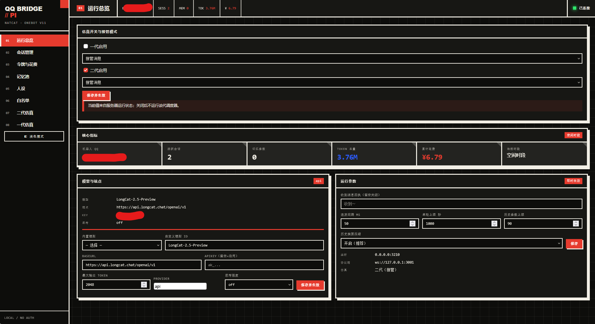

<div align="center">

# LismQQ-bot

**在超低配 Linux 上跑起来的 QQ 机器人**

NapCat（OneBot v11） ↔ pi-agent-core，单进程、无 native 依赖、ARM64 直接跑。
已在 **512M/4G 的 WiFi 棒（ARM64）** 上实测跑通。

</div>



---

## 为什么是 LismQQ-bot

想在低配机器上跑一个能自己聊天、能记人、能接梗的 QQ 机器人，通常会撞上两堵墙：

1. **原版 qq-bridge 依赖 harness / DSH**，而 harness 在 ARM64、低内存设备上装不起来；
2. 很多机器人框架带 native 依赖（数据库、图像库、编译工具链），在 512MB 内存的棒子上 `npm install` 就失败。

LismQQ-bot 把这两件事都绕开了：

- **单 Node 进程**：不连 harness、不连 DSH、不连 SnowLuma，Agent 直接跑在进程内；
- **零 native 依赖**：只依赖 `@earendil-works/pi-*` 和 `typebox`，纯 JS，`npm install` 不需要编译；
- **低内存**：systemd 单元默认 `MemoryMax=512M`，512MB 内存设备可运行；
- **ARM64 友好**：Node 官方 ARM64 构建即可，不需要交叉编译。

> 已经在 512M/4G 的 4G 随身 WiFi 棒（ARM64）上跑通：收消息、唤醒、回复、观察、记忆、控制台都正常。

---

## 应用场景

| 场景 | 说明 |
|---|---|
| **4G 随身 WiFi 棒 / 随身路由** | 512M 内存、ARM64、无风扇，插电即跑 |
| **电视盒子 / 旧手机 / 开发板** | 树莓派、香橙派、玩客云等 ARM64 设备 |
| **软路由 / NAS 旁挂** | 和现有服务共存，只占一个端口 |
| **装不了 harness 的机器** | 原版 qq-bridge 的替代实现，功能对齐主要能力 |
| **想低成本试水** | 一台几十块的棒子 + 一个模型 API Key 就能跑 |

不适合：需要表情包斗图、语音、主动戳人、多角色卡等重度拟真玩法的场景（见「已知边界」）。

---

## 核心能力

| 能力 | 说明 |
|---|---|
| **多模型** | 内置 DeepSeek 目录；任意 OpenAI 兼容端点（LongCat 等）填 `baseUrl + apiKey` 即用 |
| **会话持久化** | 每个 QQ 会话一份 transcript，重启恢复；超长自动摘要压缩 |
| **长期记忆** | CJK bigram 记忆池，中文子串可召回；按会话隔离 |
| **14 个 QQ 工具** | 读未读 / 群历史 / 发消息 / 引用回复 / 连发 / 观察等待 / 设唤醒 / 记记忆 |
| **二代仿真** | AI 自主收发：合并窗口、分档限频、巡逻、睡眠定时、回复检查、防呆 |
| **一代仿真** | 四相状态机：观望 / 活跃 / 试探 / 退场，选择性参与 |
| **Web 控制台** | 8 个页面，运行状态 / 会话 / 花费 / 记忆 / 人设 / 白名单 / 两代仿真 |
| **安全** | 收发双侧白名单、出站脱敏、SSRF 防护、单实例锁 |
| **低配友好** | 单进程、纯 JS、无编译、内存可控、日志轮转 |

---

## 快速开始

### 1. 准备

- 运行中的 NapCat，开启 OneBot v11 **正向 WebSocket**（默认 `ws://127.0.0.1:3001`）与 HTTP API（默认 `http://127.0.0.1:3000`）
- Node.js **≥ 22.19**（ARM64 官方构建即可）
- 一个模型 API Key（DeepSeek，或任意 OpenAI 兼容端点）

### 2. 安装

```bash
git clone <本仓库地址> LismQQ-bot
cd LismQQ-bot
npm install
cp config.example.jsonc config.json
```

### 3. 配置

编辑 `config.json`，最少改这几项：

```jsonc
{
  "qq": {
    "wsUrl": "ws://127.0.0.1:3001",
    "httpUrl": "http://127.0.0.1:3000",
    "accessToken": ""          // 填 NapCat 的 OneBot token（没设就留空）
  },
  "model": {
    "baseUrl": "https://api.deepseek.com",
    "provider": "deepseek",
    "model": "deepseek-flash",
    "apiKey": ""               // 留空则读环境变量 DEEPSEEK_API_KEY
  },
  "allow": {
    "groups": ["你的群号"],     // 只响应白名单里的群
    "private": [],
    "allowAllWhenEmpty": false
  }
}
```

使用自定义端点（例如 LongCat）：

```jsonc
"model": {
  "baseUrl": "https://api.longcat.chat/openai/v1",
  "provider": "api",
  "model": "LongCat-2.5-Preview",
  "apiKey": "ak_..."
}
```

### 4. 启动

```bash
export DEEPSEEK_API_KEY=sk-...   # 或写进 config.model.apiKey
npm start
```

看到下面两行就成功了：

```
[bridge] 内部 HTTP 就绪 http://127.0.0.1:3210
[bridge] 机器人身份: <QQ号>
```

浏览器打开 `http://<设备IP>:3210/` 进入控制台。

---

## 控制台

浏览器打开 `http://<设备IP>:3210/`，八个页面覆盖日常运维：

| 页面 | 能做什么 |
|---|---|
| **运行总览** | 看连接状态、机器人 QQ、会话数、token 总量、累计花费；热切换模型与运行参数 |
| **会话管理** | 查看每个 QQ 会话、中断正在跑的回合、清除会话 |
| **令牌与花费** | 按会话看 token 用量与金额，含峰谷时段走势图 |
| **记忆池** | 查看 / 删除长期记忆 |
| **人设** | 在线编辑 `roles/default.md`，保存即生效（历史会话保留） |
| **白名单** | 增删允许的群 / 私聊，立即生效 |
| **二代仿真** | 看唤醒状态、手动唤醒、切潜水/活跃、改调度参数、写会话初始提示词 |
| **一代仿真** | 看四相状态、手动设相位、投喂摘要、改参与参数 |

> 控制台默认免 token（靠 Origin 校验防跨站）。监听 `0.0.0.0` 时只应在局域网使用，**不要把端口映射到公网**。

---

## 两种仿真模式

### 二代仿真（推荐）

AI 像群友一样自主收发。桥接侧维护四个定时器（合并窗口 / 睡眠 / 巡逻 / 回复检查），到点把「唤醒 prompt」投给 AI，AI 自己决定读未读、发言、观察、设置下次醒来的条件。

- **唤醒限频分四档**：`direct`（@/私聊/戳）、`followUp`（接我的话）、`normal`（名字/提问/关键词）、`proactive`（巡逻/定时），互不挤占
- **睡前观察**：回应后可以 `qq_wait_for_messages` 观察有没有人接话，每回合 12 分钟预算
- **防呆**：无触发条件自动重置、连续 3 次空醒重置、潜水时强制保留 @ 唤醒

完整机制见 **[README-V.md](README-V.md)**。

### 一代仿真

四相状态机：观望 → 活跃 → 试探 → 退场。观望期按概率参与，活跃期选择性沉默，冷场试探，活跃 15–30 分钟后自然退场。AI 用 `[SILENT]` 潜水、用 CJK 空格分条。

两层可以共存：v2 管唤醒与自主收发，v1 管参与节奏。

---

## 常用命令

```bash
npm start            # 前台启动
npm test             # 全量离线测试（无需 API Key）
npm run self-test    # 冒烟自检

./start.sh           # 后台守护启动（setsid，断开 SSH 不影响）
./start.sh --foreground   # 前台调试
./stop.sh            # 停止（清理监督进程 / 桥接 / 孤儿 MCP / 残留锁）
./stop.sh --status   # 只看状态
```

---

## 部署到低配 ARM64 设备

### 方式一：systemd（推荐）

```bash
sudo cp lismqq-bot.service /etc/systemd/system/
sudo systemctl daemon-reload
sudo systemctl enable --now lismqq-bot
journalctl -u lismqq-bot -f
```

`lismqq-bot.service` 里记得改 `User` / `WorkingDirectory`，并把 API Key 写进 `Environment=`（不要写进 config.json）。单元默认带 `MemoryMax=512M` 与 `CPUQuota=80%`，低配设备可直接用。

### 方式二：start.sh

```bash
./start.sh
tail -f state/bridge.log
```

`start.sh` 会 `setsid` 脱离终端、进程退出 5 秒后自动重启、日志超过 5MB 自动清空，适合没有 systemd 的精简系统。

### 低配优化建议

- **内存**：`MemoryMax=512M` 够用；图片走磁盘引用（`state/images/`），不占会话内存
- **存储**：小盘设备（≤4G）用 `./disk-cleanup.sh` 一键回收（见下节）
- **日志**：`start.sh` 已做 5MB 轮转；systemd 用 `journalctl --vacuum-size`
- **swap**：512MB 设备建议开 256–512MB swap，防 `npm install` / 摘要压缩时 OOM
- **模型**：低配设备建议用便宜、响应快的模型（如 `deepseek-flash`），少开 `thinkingLevel`

### 存储维护（小盘设备）

3.3G 小盘上 QQ 生态（本体 + 缓存）是空间大户。`disk-cleanup.sh` 把这套维护固化了：

```bash
./disk-cleanup.sh --status        # 只看占用报告
./disk-cleanup.sh                 # 交互清理（apt 缓存 / journald / QQ 缓存 / bot 旧图）
./disk-cleanup.sh --full          # 全量：QQ 运行中会询问，自动"停 QQ → 清缓存 → 重启 QQ"
./disk-cleanup.sh --full --auto   # 全量无人值守（同上，不询问）
```

安全设计：聊天记录数据库（`nt_db`）、QQ 程序本体、NapCat 运行时永不触碰；脚本中断会自动恢复 QQ；每次操作写 `state/disk-cleanup.log`。建议每月或磁盘 85% 时跑一次。

### 验证

```bash
curl http://127.0.0.1:3210/status
```

---

## 项目结构

```
LismQQ-bot/
├─ src/
│  ├─ bridge.js            调度总控（入站/唤醒/回合/发送/控制台）
│  ├─ onebot.js            OneBot v11 客户端（WS + HTTP）
│  ├─ pi-host.js           SessionAgent / SessionManager（pi 封装）
│  ├─ social-v2.js         二代仿真状态仓库
│  ├─ wake-scheduler.js    唤醒调度器（合并/限频/巡逻/睡眠/防呆）
│  ├─ social-v1.js         一代仿真四相状态机
│  ├─ memory-pool.js       CJK bigram 记忆池
│  ├─ mcp/
│  │  ├─ qq-tools-server.mjs    14 个 QQ 工具
│  │  ├─ web-search-server.mjs  只读联网搜索
│  │  └─ wrap.js                MCP → AgentTool 包装
│  └─ ...                  媒体/转发/脱敏/价目等工具模块
├─ public/
│  ├─ console.html         控制台
│  └─ alpine.js            本地 Alpine.js（无外网依赖）
├─ roles/default.md        人设文件
├─ scripts/
│  └─ clean-legacy-images.mjs   存量内联图片清理（一次性）
├─ disk-cleanup.sh         存储回收（apt/journal/QQ 缓存，QQ 生命周期自动管理）
├─ state/                  运行时数据（会话/记忆/账本/锁/图片落盘）
├─ config.example.jsonc    配置模板
├─ README.md               本文件
└─ README-V.md             项目详细技术文档
```

---

## 文档

- **[README-V.md](README-V.md)** — 项目详细技术文档（架构 / 模块 / 数据流 / 仿真 / 记忆 / 安全 / 配置 / 部署）

---

## 已知边界

- 记忆是**词面匹配**：零词面重叠的同义改写召回不到
- 图片走简化链路：≤1 MiB，jpeg/png/webp/gif；GIF 不抽帧
- 自定义端点的金额按 0 计（价目表只内置 DeepSeek），token 照常统计
- 同一会话的回合严格串行；跨会话并发
- 未实现：表情包斗图、语音、主动戳人、多角色卡、斜杠命令
- 控制台免鉴权，**不要暴露到公网**

---

## 致谢与灵感来源

本项目的部分设计受到 **qq-bridge**（harness 扩展版 QQ 桥接）的启发，包括但不限于：唤醒触发与合并窗口、二代/一代仿真思路、分档唤醒限频、未读三水位、睡前观察与防呆机制、CJK 记忆池等。实现层已重写为基于 pi-agent-core 的进程内版本，不依赖 harness / DSH / SnowLuma。

长期记忆池参考了 LightphpAgent 的 `SharedMemoryPool`（Apache-2.0）实现。

---

## 许可

本项目采用 [Apache License 2.0](LICENSE) 许可。
